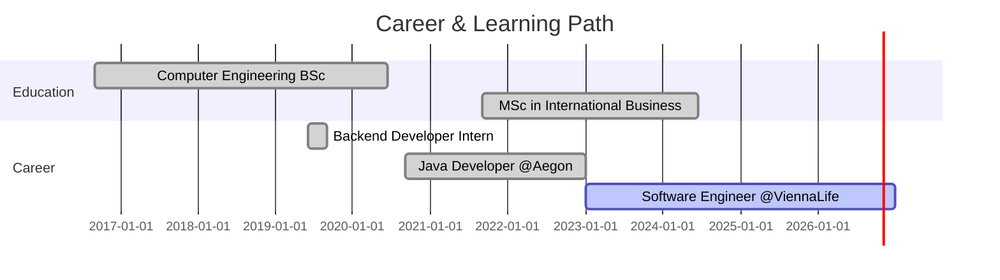

<h1 align="center">🚀 Hi there, I'm Barış Karapelit 👋</h1>
<h3 align="center">💻 Full Stack Developer | ☁️ Cloud & DevOps Enthusiast | 🧠 Lifelong Learner</h3>

  
  
  
  
  

---

### 👨‍💼 About Me

- 🔭 Exploring scalable microservices with **Spring Boot**, **Docker**, and **Kubernetes**
- 🌱 Diving deeper into **C#** and **JavaScript**, and learning **Go**
- 💬 Ask me anything on my **[issues page][issues page]**
- 🎯 Passionate about clean architecture and solving real-world problems

---

### 🛠️ Tech Stack & Tools

<!-- [GÜNCELLENECEK] Remove any you don't actively use: ts, jenkins, mongodb, postgresql, azure -->

  
  

---

### 📌 Featured Projects

- 🔐 [User Management System](https://github.com/CodeWizardGenius/user-management) — Role-based user and permission management with Spring Security
- 💬 [Messaging API Integration](https://github.com/CodeWizardGenius/smartmessage-integration) — SmartMessage/Moreum messaging integration with an async architecture
<!-- [GÜNCELLENECEK] Add current project if any: - 🚀 [Project Name](link) — one-line description -->

---

### 📫 Let's Connect

Always happy to collaborate, learn from others, or just chat about tech:

- 💼 [LinkedIn](https://www.linkedin.com/in/baris-karapelit/)
- 💬 [GitHub Discussions](https://github.com/CodeWizardGenius?tab=discussions)
- 📮 Got a question? Open an issue on my [repo issues page][issues page]

---

### 🎯 Learning Goals

> [GÜNCELLENECEK] Confirm current goals and target dates.

- 🧠 Advanced Go (Golang) concurrency and microservices
- ☸️ Kubernetes operator design & GitOps
- 🛡️ OpenID Connect & enterprise-level authentication
- 📊 Observability with OpenTelemetry and distributed tracing

---

### ✨ Fun Facts

- 🎮 I love strategy games and tinkering with automation tools in my free time.
- 🎧 I listen to Yalın while coding — music keeps the creativity flowing!
- 🧩 I enjoy solving algorithm challenges and participating in hackathons.
- 🌍 I'm curious about global tech communities and cross-cultural collaboration.

---

### 📜 Certifications

- ☁️ AWS Certified Cloud Practitioner — [GÜNCELLENECEK: completed / in progress]
- ✅ Java Spring Professional Track (Patika+)
- ✅ Docker & Kubernetes Hands-On (Udemy)
- ✅ OpenSearch Essentials (self-paced)

---

### 📅 Timeline

[issues page]: https://github.com/CodeWizardGenius/CodeWizardGenius/issues
